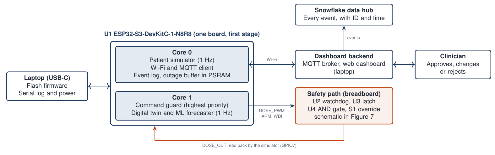
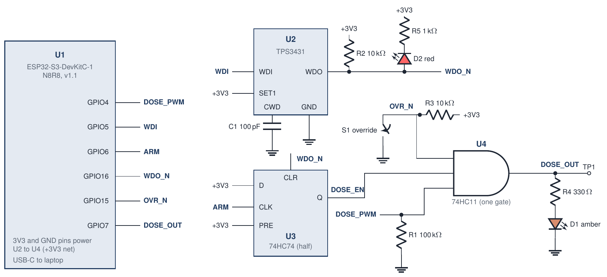
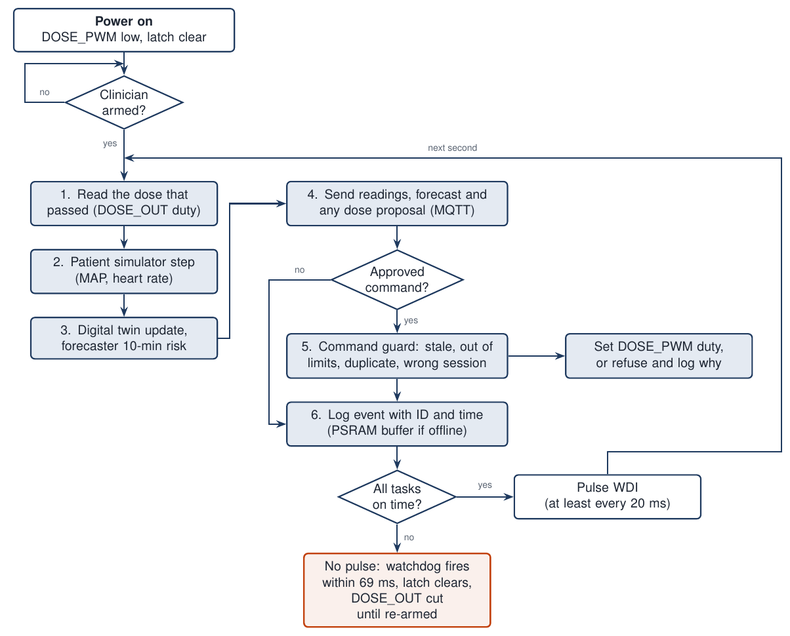

# Hardware: circuit design

TwinCare's first prototype runs on one development board (a ready-made circuit board built around one chip). The board runs the simulated patient, the digital twin, the forecaster and the command guard. A small safety circuit sits between the board and the dose signal. In December we design our own printed circuit board (PCB) around the same chip.

**Current design:** board ESP32-S3-DevKitC-1-N8R8, safety circuit version 1 (30 Oct 2026).

## Design log

| Date | Document version | Change |
|---|---|---|
| 27 Oct 2026 | | Team decision: one board runs the simulated patient, the twin, the forecaster and the command guard |
| 30 Oct 2026 | 1.0 | Board chosen. Safety circuit version 1 drawn: watchdog, latch, AND gate and override switch |
| 30 Oct 2026 | 1.1 | Text rewritten for first-time readers. Circuit unchanged |
| 30 Oct 2026 | 1.3 | Secure links added: TLS with certificates at both ends, private key kept in the chip's hardware |
| 30 Oct 2026 | 1.4 | Current version. AI use note added. Circuit unchanged |

## Next steps

| By | Step |
|---|---|
| 6 Nov 2026 | Order one board and the safety circuit parts |
| 13 Nov 2026 | Build the safety circuit on a breadboard and measure how fast it cuts the dose |
| 20 Nov 2026 | Run the simulated patient on the board and compare it with the desktop model (DI-02) |
| 27 Nov 2026 | Gate: one simulated patient runs end to end on the board for an hour |
| Dec 2026 | Custom PCB: schematic, layout and order |
| Mid-Jan 2027 | Custom PCB sent for manufacture, before Chinese New Year closes factories (6 Feb 2027) |

## Board

We scored four boards from 1 (poor) to 5 (best) on five criteria. Each criterion carries a weight, its share of the total score.

| Criterion (weight) | ESP32-S3-DevKitC-1 | Arduino Nano ESP32 | Raspberry Pi Pico 2 W | Arduino UNO R4 WiFi |
|---|---|---|---|---|
| Cost (15 %) | 4 | 3 | 5 | 3 |
| Wi-Fi (20 %) | 5 | 5 | 4 | 3 |
| Computing power and memory (25 %) | 5 | 5 | 4 | 2 |
| Ease of moving to our own board (25 %) | 5 | 4 | 3 | 3 |
| Team familiarity (15 %) | 4 | 5 | 3 | 5 |
| **Weighted total** | **4.70** | **4.45** | **3.75** | **3.05** |

- **Weight check:** with all five weights equal, the ESP32-S3 board still wins, 4.60 against 4.40. The Nano ESP32 wins only if team familiarity carries more than 32 % of the total.
- **Memory decided it:** DI-07 says the bench keeps working through a 10-minute network outage and loses no records. At one record per second and about 1 KB per record, the board must hold about 600 KB. The ESP32-S3 board has 8 MB of PSRAM (extra working memory on a second chip). The Pico 2 W has 520 KB in all.
- **Cost:** about CA$24. We buy one board, so most of the hardware budget goes to the custom PCB.

## Prototype layout

*The dose signal leaves the board, passes the safety circuit and comes back to the simulator. The dose is only an electrical signal. No pump or drug is involved.*

## Safety circuit, version 1

The safety circuit can cut the dose without the firmware (the program on the board). The board sends the dose on DOSE_PWM, a pulse train whose on-time sets the dose. After the safety circuit, the signal is DOSE_OUT. DOSE_OUT carries a dose only when all three conditions hold:

1. The firmware is sending a dose.
2. A clinician has armed the bench, and the watchdog has not fired since.
3. The override switch S1 is open.

| Part | Chip or value | Job |
|---|---|---|
| U1 | ESP32-S3-DevKitC-1-N8R8 | Runs the firmware and sends DOSE_PWM |
| U2 | TPS3431 watchdog (a timer chip) | Raises a fault on WDO if the firmware stops its pulse. The firmware pulses it every 20 ms |
| C1 | 100 pF | Sets the watchdog wait: 62.7 ms typical, 69.1 ms worst case. DI-05 allows 100 ms |
| U3 | 74HC74 latch (one half) | Holds the cut after a watchdog fault, until a clinician re-arms the bench. The TPS3431 fault lasts 200 ms, then clears on its own |
| U4 | 74HC11 AND gate (one gate) | Passes the dose only when all three conditions hold |
| S1 | Override switch | Cuts the dose by hand, whatever the firmware does |
| R1 | 100 kΩ to ground | Holds the dose at zero while the board restarts |
| R2, R3 | 10 kΩ to +3.3 V | Hold WDO_N and OVR_N high until a fault or the switch pulls them low |
| R4, D1 | 330 Ω, amber light | Lights when a dose passes |
| R5, D2 | 1 kΩ, red light | Lights on a watchdog fault |
| TP1 | Test point | Probe point for DOSE_OUT |

- **Timing:** the watchdog datasheet gives t = 77.4 × C + 55 ms, with C in nF. For C1 = 100 pF this is 62.7 ms.
- **Start-up:** the firmware waits 100 ms before its first pulse. The watchdog fires once and clears the latch, so the bench always starts with the dose cut.
- **Read-back:** the board reads DOSE_OUT, the dose that passed the circuit. This shows that the hardware and software talk to each other, as the sponsor asked.
- **Supply:** each logic chip gets a 0.1 µF decoupling capacitor next to its supply pin (not drawn).
- **Breadboard and PCB:** the breadboard uses 74HC74 and 74HC11 chips with legs. The custom PCB can use the smaller 74LVC1G74 and 74LVC1G11. The TPS3431 comes only in a tiny package with no legs, so the breadboard uses TI's evaluation board or an adapter.

### Board pins

| Pin | Signal | Direction | Use |
|---|---|---|---|
| GPIO4 | DOSE_PWM | Out | Dose the firmware wants to send |
| GPIO5 | WDI | Out | Watchdog pulse, every 20 ms while the program runs on time |
| GPIO6 | ARM | Out | Arms the latch after a clinician enables the bench |
| GPIO7 | DOSE_OUT | In | Dose that passed the safety circuit, read by the simulator |
| GPIO15 | OVR_N | In | Override switch position, recorded |
| GPIO16 | WDO_N | In | Watchdog fault, recorded |
| GPIO38 | RGB LED | Out | Status light on the board |

## Firmware loop

*Each second the board reads the dose that passed, steps the simulated patient, updates the twin and the forecaster, and sends results to the dashboard. An approved dose goes through the command guard before it changes the dose signal. The watchdog pulse comes last, so a stuck program stops the pulses and the dose is cut.*

## Secure links

Every TwinCare link uses TLS 1.2 or newer, with a certificate checked at both ends (proposed DI-18). The ESP32-S3 keeps its private key in its digital signature unit, where no program can read it. Secure boot runs only firmware we have signed, and flash encryption protects stored keys and data.

## Files

| File | Contents |
|---|---|
| [img/](img) | Figures on this page (PNG) |
| [src/](src) | LaTeX sources of the figures. The schematic uses the circuitikz package |
