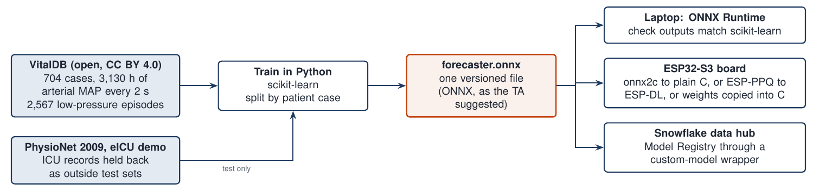

# Small ML models

The forecaster warns before blood pressure falls too low. DI-03 asks for a warning at least 10 minutes before MAP (mean arterial pressure, the average blood pressure over one heartbeat) falls below 65 mmHg. These small machine learning (ML) models test the pipeline around the forecaster: the scoring code, and the path from Python to the board.

| Model | Date | Data | What it tests | Result |
|---|---|---|---|---|
| [Forecaster dry run](#forecaster-dry-run): logistic regression | 14 Oct 2026 | 450 runs of our simulated patient | The DI-03 scoring code | Warned 10 min ahead of 30 % of drops, with 1.8 false alerts per hour. A plain MAP alarm warned 10 min ahead of none |
| [ONNX check](#onnx-conversion-check): logistic regression | 30 Oct 2026 | VitalDB, 120 surgeries | Same predictions after conversion to ONNX | 31 numbers, 625 bytes, largest difference 0.00000009 |
| [ONNX check](#onnx-conversion-check): small neural network | 30 Oct 2026 | VitalDB, 120 surgeries | Same predictions after conversion to ONNX | 213 numbers, 2.1 KB, largest difference 0.0000003 |

A logistic regression is a weighted sum of recent readings, turned into a probability. A neural network stacks several weighted sums with simple bends between them, so it can learn curved patterns.

## Forecaster dry run

[forecaster_dryrun_v2.py](forecaster_dryrun_v2.py) builds 450 one-hour runs of the simulated patient, each with a random fall in pressure and a random patient response. It trains on 300 runs and tests on the other 150. Each minute the model reads six numbers: the current MAP, its trend over the last 5 minutes and the last 2 minutes, the current dose, the dose change over the last 3 minutes, and a straight-line projection of MAP 10 minutes ahead. It gives the chance that MAP falls below 65 mmHg in the next 10 minutes.

Scoring rules:

- A drop counts only if it starts at minute 16 or later, so a 10-minute warning was possible.
- An alert needs 2 minutes in a row. An alert that stays on counts again every 10 minutes.
- Every alert threshold is chosen on the training runs only, then applied once to the test runs.

Test results, with the threshold set to allow up to 2 false alerts per hour on the training runs:

| Method | Drops warned 10 min ahead | Median warning | False alerts per hour |
|---|---|---|---|
| Logistic regression (threshold 0.49) | 24 of 79 (30 %) | 7 min | 1.8 |
| Plain MAP alarm (alerts below 67.75 mmHg) | 0 of 79 | 2 min | 1.6 |

The dry run uses data from our own simulated patient, so it checks the scoring code. Next, the team trains the forecaster on VitalDB and scores it the same way against DI-03. Full results: [forecaster_results_v2.json](forecaster_results_v2.json).

## ONNX conversion check

ONNX (Open Neural Network Exchange) is an open file format for trained models. We train a model once in Python, save it as one `.onnx` file, and run that same file on the laptop, the board and the database.



[onnx_check.py](onnx_check.py) uses VitalDB, a free database of surgical patients (CC BY 4.0 licence). Each model reads the last 10 minutes of MAP, as one-minute medians, and gives the chance of MAP below 65 mmHg in the next 10 minutes. It cuts 120 surgeries into 25,930 windows. It trains on 90 surgeries and tests on 5,983 windows from the other 30, which the models never saw. Both models are converted to ONNX with skl2onnx and run with ONNX Runtime, the standard program for ONNX files.

| Model | Numbers inside | File | Largest difference after conversion |
|---|---|---|---|
| Logistic regression | 31 | [logreg.onnx](logreg.onnx), 625 bytes | 0.00000009 in predicted probability |
| Neural network, 16 hidden units | 213 | [mlp16.onnx](mlp16.onnx), 2.1 KB | 0.0000003 in predicted probability |

What this means for the board:

- **Speed:** even the neural network needs only a few hundred multiplications per prediction, once a second.
- **Logistic regression:** we copy its 31 numbers straight into the board's C code.
- **Neural network:** Espressif's ESP-DL tool runs ONNX models on the ESP32-S3, and the free onnx2c tool turns them into plain C. ONNX on the board pays off once the forecaster grows into a neural network.

Full results: [onnx_check.json](onnx_check.json).

## Run

```bash
python3 forecaster_dryrun_v2.py
python3 onnx_check.py <folder of VitalDB .parquet files> <output folder>
```

The dry run needs numpy and scikit-learn, and imports the simulated patient from `reference/`. The ONNX check also needs pandas, skl2onnx and onnxruntime. VitalDB data is not in this repository: download it from [vitaldb.net](https://vitaldb.net).
